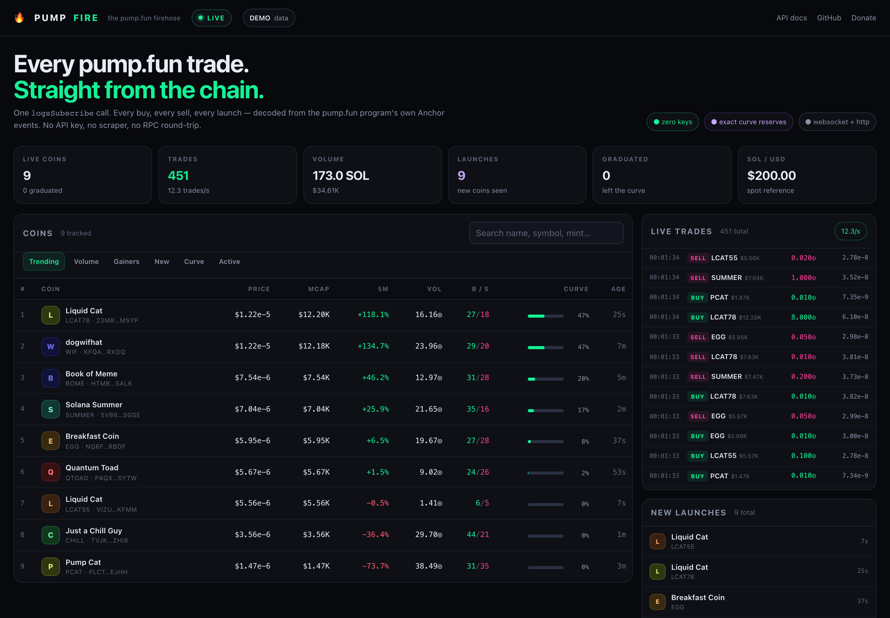
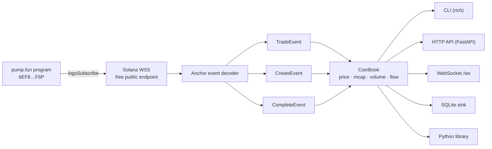

<div align="center">

# 🔥 PumpFire

### Every pump.fun trade. Straight from the chain. Zero API keys.

**The missing real-time data layer for pump.fun.**  
One WebSocket subscription. Every buy, every sell, every launch — decoded from the pump.fun program's own Anchor events. No scraping. No REST polling. No rate-limit tax.

[](#development)
[](https://www.python.org/)
[](LICENSE)
[](#why-this-exists)
[](#contributing)

[Quickstart](#-quickstart) · [Live dashboard](#-live-dashboard) · [API](#-http--websocket-api) · [Python library](#-python-library) · [How it works](#-how-it-works) · [Donate](#-support-the-firehose)

</div>

---



---

## Why this exists

pump.fun doesn't ship a public trade API. The usual workaround is a headless browser, a rotating proxy pool, and a scraper that breaks every other week.

You don't need any of that.

Every pump.fun trade emits an Anchor `TradeEvent` inside the transaction logs. A single `logsSubscribe` call on the pump.fun program delivers those logs in real time — including the mint, wallet, side, SOL size, token size, timestamp, fees, and the **exact post-trade bonding-curve reserves**.

That means price, market cap, and curve progress are read from the chain, not estimated from a price feed or scraped from a UI.

PumpFire turns that stream into a clean, queryable feed:

- ⚡ **Live trades** — every buy/sell, with wallet, size, price, fees, and market cap
- 🪙 **Coin intelligence** — name, symbol, metadata, image, socials, creation time
- 📈 **Market state** — exact price, market cap, volume, buys/sells, unique traders, 1m/5m change
- 🎓 **Graduations** — `CompleteEvent` marks the moment a coin leaves the curve
- 🆕 **Launches** — `CreateEvent` gives you the mint, name, symbol, URI, and creator
- 🔌 **Three ways in** — CLI, HTTP/WebSocket API, Python library
- 🧠 **Zero RPC** — the event carries everything; no `getTransaction` per trade
- 🆓 **Zero keys** — free public Solana WebSocket endpoints by default
- 💾 **Optional SQLite** — batch-persisted, non-blocking, ready for research

> **Not financial advice.** This is a data tool, not a trading bot. It never signs, never trades, and never touches a wallet.

---

## Quickstart

```bash
git clone https://github.com/0xJ1nn/pumpfun-firehose.git
cd pumpfun-firehose
python -m venv .venv
source .venv/bin/activate
pip install -e .
```

### 1. Watch the firehose in your terminal

```bash
pumpfire stream
```

```
┌─ 🔥 PUMPFIRE  LIVE   63 msg/s   61.2 trades/s   94 coins   2140.7 SOL   $200.00 ─┐
├─ TOP COINS ────────────────────────────────┬─ LIVE TRADES ────────────────────────┤
│ #  Coin          Price       MCap    5m    │ Time      Side  Coin     SOL    Price │
│ 1  WHACKADON     3.99e-08    $7.9K   +42%  │ 12:04:31  BUY   WIF      1.420  3.1e-8│
│ 2  SUMMER        2.31e-07    $22.1K  +0.0% │ 12:04:31  SELL  BOME     0.518  1.2e-7│
│ 3  CHILL         2.17e-07    $20.7K  -3.1% │ 12:04:32  BUY   EGG      0.050  3.1e-8│
└────────────────────────────────────────────┴──────────────────────────────────────┘
```

### 2. Launch the dashboard + API

```bash
pumpfire api
```

Open **http://127.0.0.1:8000** for the live dashboard.  
Open **http://127.0.0.1:8000/docs** for the interactive API reference.

Want to see it without the network?

```bash
pumpfire api --demo
```

### 3. Query it like an API

```bash
curl -s 'localhost:8000/v1/coins?limit=5&sort=mcap' | jq
curl -s 'localhost:8000/v1/coins/<mint>' | jq
curl -s 'localhost:8000/v1/trades?min_sol=1&limit=10' | jq
curl -s 'localhost:8000/v1/creates?limit=10' | jq
```

### 4. Keep the tape

```bash
pumpfire api --db pumpfire.db
pumpfire export --db pumpfire.db --table trades --format csv --out trades.csv
```

---

## What you can build with it

| Use case | How |
|---|---|
| Live terminal monitor | `pumpfire stream` |
| Coin screener / dashboard | `pumpfire api` + `/v1/coins` |
| Trade tape / alerts | `/v1/trades`, `/ws` |
| New-launch feed | `/v1/creates` |
| Research / backtesting | `--db pumpfire.db` + `pumpfire export` |
| Wallet-flow analysis | trade events + `user` field |
| Your own bot | `from pumpfire import Firehose` |
| Discord/Telegram alerts | subscribe to the Python callback or WebSocket |

---

## How it works



The decoder reads the `Program data:` lines from each notification. No transaction fetch, no RPC round-trip, no block parsing.

### One subscription, the whole launchpad

```json
{
  "jsonrpc": "2.0",
  "id": 1,
  "method": "logsSubscribe",
  "params": [
    { "mentions": ["6EF8rrecthR5Dkzon8Nwu78hRvfCKubJ14M5uBEwF6P"] },
    { "commitment": "processed" }
  ]
}
```

That is the entire data source.

### The event layouts

**TradeEvent** — 121 fixed bytes after the discriminator, plus optional fee fields:

```
mint(32) | sol_amount(u64) | token_amount(u64) | is_buy(u8) | user(32)
| timestamp(i64) | virtual_sol(u64) | virtual_token(u64)
| real_sol(u64) | real_token(u64)
| fee_recipient(32) | fee_bps(u64) | fee(u64)
| creator(32) | creator_fee_bps(u64) | creator_fee(u64) | ...
```

**CreateEvent**:

```
name(string) | symbol(string) | uri(string)
| mint(32) | bonding_curve(32) | user(32)
| creator(32) | timestamp(i64) | virtual_token(u64) | virtual_sol(u64)
| real_token(u64) | total_supply(u64) | ...
```

**CompleteEvent**:

```
user(32) | mint(32) | bonding_curve(32) | timestamp(i64)
```

Anchor strings are a little-endian `u32` length followed by UTF-8 bytes. Anything that does not parse cleanly is dropped, never guessed.

### The math

Because the `TradeEvent` carries the post-trade reserves:

```text
price       = virtual_sol / virtual_token
market cap  = price × total_supply
curve %     = 1 − real_token / initial_real_token
```

No price oracle. No estimation. The reserves are the chain state at the moment of the trade.

---

## Live dashboard

The dashboard is a **single static HTML file** served by the API. No build step, no npm, no CDN, no external fonts.

- Live coin table: price, market cap, 1m/5m change, volume, buys/sells, curve progress, age
- Trade tape with buy/sell coloring, size, price, and market cap
- New-launch feed with image, name, symbol, and age
- Coin detail: contract address, creator, metadata, socials, recent trades, flow
- Search, sort, filter, dark mode (the only mode)
- WebSocket updates with polling fallback
- `--demo` mode with deterministic simulated data

---

## HTTP + WebSocket API

Start:

```bash
pumpfire api --host 127.0.0.1 --port 8000
```

| Method | Path | Description |
|---|---|---|
| `GET` | `/health` | Liveness + stream age |
| `GET` | `/v1/stats` | Global counters, rates, SOL/USD |
| `GET` | `/v1/coins` | List coins (`sort`, `q`, `limit`, `graduated`, `min_mcap`) |
| `GET` | `/v1/coins/{mint}` | One coin + recent trades |
| `GET` | `/v1/coins/{mint}/trades` | Trades for a mint |
| `GET` | `/v1/trades` | Global tape (`mint`, `side`, `min_sol`, `limit`) |
| `GET` | `/v1/creates` | New launches |
| `GET` | `/v1/completes` | Graduations |
| `WS` | `/ws` | 1 Hz snapshot: stats + top coins + trades + creates |

Example coin:

```json
{
  "mint": "7xvRK69JGaXajoguXJRQGTMmCHqWXLNpvcK27yLpC8Gk",
  "name": "Whack-A-Don",
  "symbol": "WHACKADON",
  "price_sol": 3.997e-8,
  "price_usd": 7.99e-6,
  "market_cap_sol": 39.97,
  "market_cap_usd": 7994.87,
  "curve_progress_pct": 23.76,
  "volume_sol": 12.82,
  "buys": 11,
  "sells": 6,
  "unique_buyers": 3,
  "change_1m_pct": 21.39,
  "change_5m_pct": 42.97,
  "graduated": false,
  "age_s": 97.4
}
```

The API also serves interactive OpenAPI docs at **`/docs`** while it is running.

---

## Python library

```python
import asyncio
from pumpfire import CoinBook, Firehose

async def main():
    book = CoinBook()

    async def on_event(event):
        if event.kind != "trade" or event.sol < 1:
            return
        coin = book.get(event.mint)
        symbol = (coin.symbol or coin.name) if coin else event.mint[:6]
        side = "BUY " if event.is_buy else "SELL"
        print(f"{side} {symbol:<12} {event.sol:>7.3f} SOL @ {event.price_sol:.3e}")

    firehose = Firehose(book, on_event=on_event)
    await firehose.start()
    await asyncio.sleep(3600)
    await firehose.stop()

asyncio.run(main())
```

More in [`examples/`](examples/):

- [`basic_stream.py`](examples/basic_stream.py) — print every event
- [`filter_big_buys.py`](examples/filter_big_buys.py) — alert on large buys of young coins
- [`rest_api.py`](examples/rest_api.py) — run the dashboard from Python
- [`sqlite_sink.py`](examples/sqlite_sink.py) — persist the tape

---

## CLI

```bash
pumpfire stream                          # live terminal firehose
pumpfire stream --min-sol 1 --buys-only  # only real buys
pumpfire stream --json                   # JSONL for piping
pumpfire stream --mint <mint>            # one coin
pumpfire top --duration 60               # ranked snapshot after 60s
pumpfire api                             # dashboard + API
pumpfire api --demo                      # dashboard with fake data
pumpfire api --db pumpfire.db            # persist to SQLite
pumpfire decode --log "Program data: …"  # decode a raw log line
pumpfire export --db pumpfire.db --table trades --format csv --out trades.csv
pumpfire version
```

Every command is safe to pipe. `--json` writes one JSON object per line.

---

## Configuration

| Env var | Default | Description |
|---|---|---|
| `PUMPFIRE_WS` | public endpoints | Comma-separated WSS endpoints |
| `PUMPFIRE_SOL_USD` | auto | Fixed SOL/USD price (skips the price feed) |
| `PUMPFIRE_COMMITMENT` | `processed` | `processed`, `confirmed`, or `finalized` |
| `PUMPFIRE_METADATA` | `1` | Fetch token metadata from `uri` (`0` to disable) |
| `PUMPFIRE_DB` | — | SQLite path |
| `PUMPFIRE_LOG_LEVEL` | `INFO` | Log level |

CLI flags override env vars. Pin the price for reproducible research:

```bash
PUMPFIRE_SOL_USD=200 pumpfire api --db research.db
```

---

## Data fidelity & limits

**What is exact**

- Trade side, wallet, mint, SOL amount, token amount, timestamp: from the event.
- Price, market cap, curve progress: from the event's post-trade reserves.
- Launch name/symbol/uri/creator: from `CreateEvent`.
- Graduation: from `CompleteEvent`.
- Fees and creator fees: from the extended `TradeEvent` when present.

**What is approximate**

- USD values depend on the SOL/USD feed (Coinbase → Kraken → CoinGecko → Jupiter fallback). Use `--sol-usd` to pin it.
- Unique buyer/seller counts are exact up to 5,000 wallets per coin; beyond that the UI reports `5000+` to keep memory bounded.
- Metadata (image, description, socials) is fetched from the token's `uri` when available. IPFS/Arweave gateways can be slow; a missing image is normal.
- Public WSS endpoints can rate-limit, drop, or reconnect. PumpFire rotates endpoints, backs off, dedupes signatures, and exposes `last_message_age_s` so you can see a gap.
- `processed` commitment can be reorged. Use `--commitment confirmed` or `finalized` if you need stronger guarantees (at the cost of latency).
- The in-memory book is bounded. It is a live view, not a historical index. Use `--db` for durable history.
- Graduated coins leave the pump.fun bonding curve. PumpFire marks them and stops curve updates; post-graduation PumpSwap AMM trades are **not** part of this firehose (yet).

**What it is not**

- Not a trading bot, not a signer, not a wallet.
- Not a replacement for an indexer if you need full historical backfill.
- Not affiliated with pump.fun.

---

## Performance

A single Python process handles the full public firehose on a laptop. The hot path is:

```text
WebSocket frame → JSON parse → base64 decode → struct unpack → dataclass update
```

No per-trade RPC, no per-trade DB commit (SQLite writes are batched), no per-trade HTTP.

Measured on the public endpoints during development:

- ~100–1,500 messages/s depending on endpoint load and market activity
- ~90% of notifications carrying a decodable `TradeEvent`
- ~30–60 trades/s sustained on one process
- ~100 coins discovered in 20 seconds

Your mileage varies with endpoint load and market activity. The stream is
bursty: quiet seconds are normal, and a busy minute can deliver thousands of
notifications.

---

## Comparison

| | Web scraping | Unofficial frontend API | **PumpFire** |
|---|---|---|---|
| API key required | No | Sometimes | **No** |
| Breaks when the UI changes | Yes | Yes | **No** |
| Trade-level data | Partial | Partial | **Yes** |
| Exact bonding-curve reserves | No | No | **Yes** |
| Latency | Seconds | Seconds | **~milliseconds** |
| Durable history | No | No | **Forward SQLite sink** |
| Open source | — | — | **MIT** |

---

## Development

```bash
pip install -e ".[dev]"
pytest -q
ruff check .
mypy src
```

Tested on Python 3.10, 3.11, and 3.12.

---

## Roadmap

- [ ] PumpSwap AMM event decoding for graduated coins
- [ ] Prometheus `/metrics`
- [ ] Postgres sink
- [ ] Webhook alerts (`min_sol`, new launch, graduation)
- [ ] Historical backfill from RPC (optional, separate from the firehose)
- [ ] More dashboard views (wallet flow, curve race, launch calendar)

---

## Contributing

PRs are welcome. Good first issues:

- Add PumpSwap AMM event decoding.
- Add a Prometheus metrics endpoint.
- Add a Postgres sink.
- Add a `--mint` watchlist mode with desktop notifications.
- Improve the dashboard (keep it dependency-free).
- Add more tests for malformed event layouts.

Please open an issue before a large change. Be kind. No hype, no scams, no "guaranteed returns".

---

## License

MIT © 2026 [0xJ1nn](https://github.com/0xJ1nn)

---

## 💸 Support the firehose

PumpFire is free and always will be. If it saves you a scraping bill, a proxy bill, or a weekend, you can send a tip.

Always verify the address before sending. Crypto transfers are irreversible.

| Chain | Address |
|---|---|
| **Solana** | `H5nd3cHT5rtbYKcvtL8hhKzkw65C7DUdocbGBcKMhGrG` |
| **Ethereum** | `0x3C90CEC48FEBEFdfE8f1F146CED92de22Fc03bD7` |
| **Bitcoin** | `bc1q8ckyx62xcm6tls3x7p5hwh42wjf8ce7zj4hkan` |
| **Cash (Solana)** | `7EeottAzSf2VStnaENBe4jiSiUcMLQCgdXNb5YdyNqN2` |

> The `cash` address is a Solana wallet — a second tip jar if you want to keep it separate.
>
> Prefer contributing code? That's worth more than a tip. See [Contributing](#contributing).

---

<div align="center">
Built with ☕ and a single <code>logsSubscribe</code> call.<br/>
<sub>Not affiliated with pump.fun. Use at your own risk.</sub>
</div>
